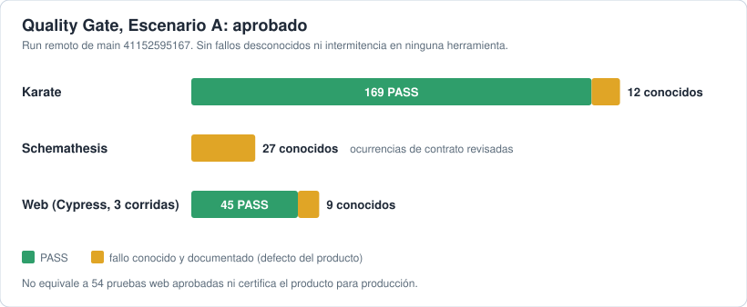
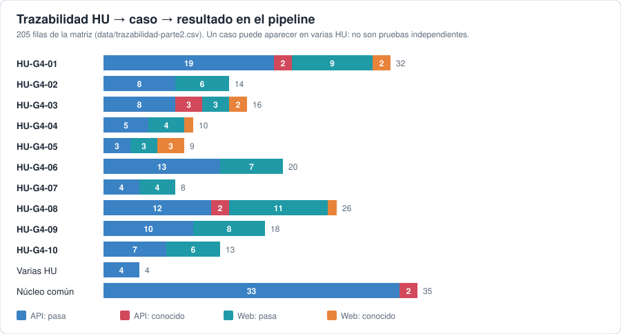
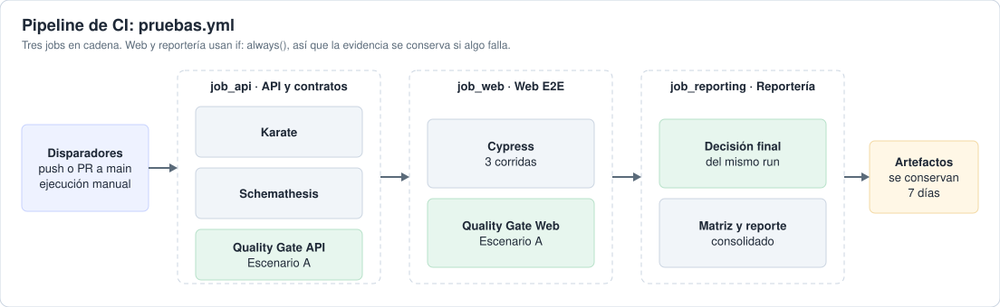

# Entrega 2 — Qolqe G4 y Quality Gate Escenario A

**Estado verificado:** el run de `main` ([41152595167](https://github.com/granitespinoza/qolqe-g4-qa/actions/runs/41152595167)) terminó en éxito en sus tres jobs. Quality Gate **Escenario A aprobado**: Karate 169 PASS y 12 conocidos, Schemathesis 27 conocidos, Web 45 PASS y 9 conocidos, sin fallos desconocidos ni intermitencia. [Resultado del gate](docs/parte2/resultado-gate.md).



## Mapa rápido

| Quiero ver… | Ir a |
|---|---|
| **Qué hay y dónde** (flujo de requisito a reporte) | [Mapa del repositorio](docs/parte2/mapa-del-repo.md) |
| Pruebas web (Cypress) | [`Web/cypress/`](Web/cypress/) · [`tests/e2e/`](tests/e2e/README.md) |
| Pruebas de API (Karate) y contrato | [`API/features/`](API/features/) · [`API/openapi.json`](API/openapi.json) |
| Pipeline de CI | [`.github/workflows/pruebas.yml`](.github/workflows/pruebas.yml) · [pipeline](docs/parte2/pipeline.md) |
| Trazabilidad HU → caso → ejecución | [CSV](data/trazabilidad-parte2.csv) · [matriz detallada](docs/parte2/trazabilidad.md) |
| Defectos encontrados | [defectos-conocidos.md](docs/parte2/defectos-conocidos.md) |
| Informe | [docs/informe.md](docs/informe.md) |

## Rúbrica de la Entrega 2: dónde está la evidencia

| Criterio (pts) | Qué hay | Evidencia |
|---|---|---|
| **Cobertura de criterios web con verificaciones significativas (5)** | 54 tests Cypress para los 18 criterios de aceptación de G4, en 36 grupos de variantes. Cada test comprueba respuesta HTTP, mensaje visible y persistencia tras recargar | [`Web/cypress/e2e/`](Web/cypress/e2e/) · [cobertura por criterio](docs/parte2/verificacion-web.md) |
| **Pipeline CI/CD con API y web, reportes y estado visible (5)** | `pruebas.yml`: job de API (Karate y Schemathesis), job de Web (tres corridas) y job de reportería. Publica reportes como artefactos y el resumen del run enlaza la matriz | [workflow](.github/workflows/pruebas.yml) · [Actions](https://github.com/granitespinoza/qolqe-g4-qa/actions) · [pipeline](docs/parte2/pipeline.md) · [política del gate](docs/parte2/quality-gate.md) |
| **Gestión de casos y trazabilidad HU → casos → ejecución (3)** | Matriz exportada con HU, caso (TC), escenario, capa, etiquetas en el código, estado en el pipeline y defecto asociado. Los tests llevan etiquetas `@HU-…` y `@TC-…` | [CSV](data/trazabilidad-parte2.csv) · [JSON](data/trazabilidad-parte2.json) · [matriz detallada](docs/parte2/trazabilidad.md) · [portal navegable](apidoc/parte2/index.html) |
| **Diseño y estabilidad: patrón mantenible, sin esperas fijas, pasa 3 veces (3)** | Page Object y comandos propios, selectores `data-testid`, ninguna espera fija (`cy.wait` con número). Tres corridas completas con el mismo resultado: 45 aprobados y 9 fallos conocidos | [`Web/cypress/pages/`](Web/cypress/pages/) · [`Web/cypress/support/`](Web/cypress/support/) · [verificación web](docs/parte2/verificacion-web.md) |
| **Exposición y demo en vivo (4)** | Presentación de 13 diapositivas, comandos de la demo y guía de ensayo | [PPT](presentacion/Entrega2-Qolqe-Cypress.pptx) · [comandos de la demo](docs/parte2/comandos-demo.txt) · [guía de ensayo](docs/parte2/entrega.md) |



Defectos encontrados: [defectos-conocidos.md](docs/parte2/defectos-conocidos.md). El Quality Gate aprueba por Escenario A, en entorno académico aislado: no equivale a 54 pruebas aprobadas.

## Pipeline de CI

Un solo workflow, [`pruebas.yml`](.github/workflows/pruebas.yml), con tres jobs en cadena. Corre en push o PR a `main` y a mano.



- Web y reportería usan `if: always()`: la evidencia se conserva aunque falle un job anterior.
- No hay `continue-on-error`: los reportes crudos conservan los FAIL y el Quality Gate decide después.
- Detalle: [pipeline](docs/parte2/pipeline.md) · [política del gate](docs/parte2/quality-gate.md).


**Estado local:** tres corridas web estables con 45 PASS y 9 known issues; API con 169 PASS y 12 known issues. Los fallos crudos permanecen visibles. Qolqe no se modifica. La aprobación se limita al entorno académico aislado.

- [Guía final de ensayo, comandos y publicación](docs/parte2/entrega.md)
- [PowerPoint para Canvas: 13 diapositivas](presentacion/Entrega2-Qolqe-Cypress.pptx)
- [Presentación web y matriz](apidoc/parte2/index.html)
- [Matriz CSV](data/trazabilidad-parte2.csv) · [Matriz detallada](docs/parte2/trazabilidad.md)
- [Política del gate](docs/parte2/quality-gate.md) · [Defectos y riesgos](docs/parte2/defectos-conocidos.md)

Estructura exigida: `API/features/` y `API/openapi.json`, `Web/cypress/`, `scripts/`, `.github/workflows/pruebas.yml`. El workflow ejecuta API → Web → Reportería en push/PR a main y manualmente. Antes de entregar hay que publicar/integrar los cambios y verificar el run remoto del commit final.

Con las dependencias instaladas, ejecutar desde la raíz:

```powershell
.venv/Scripts/python.exe scripts/ci_run.py api
.venv/Scripts/python.exe scripts/ci_run.py web
.venv/Scripts/python.exe scripts/build_web_coverage.py
.venv/Scripts/python.exe scripts/ci_run.py reporting
.venv/Scripts/python.exe scripts/build_delivery.py
```

No se usa `continue-on-error` ni se omiten pruebas. Los lanzadores crudos pueden devolver fallo por defectos; `ci_run.py` decide el gate tras contrastar la evidencia. Vídeos desactivados y bases web retiradas al terminar. La explicación de instalación y los materiales anteriores se conservan abajo; para la entrega actual prevalece la guía final enlazada arriba.

---

# Qolqe G4 · Contactos y solicitudes de dinero

**Granit y Franco · CS5383 — Pruebas y Verificación de Software**

Trabajo de QA asistido con IA: decisiones justificadas, pruebas reproducibles y evidencia real. La aplicación original se conserva sin modificaciones.

## Recorrido para la docente
0. [Levantar y probar paso a paso](docs/levantar-y-probar.md): API, HTML, selección por HU/caso y ejecución completa.
1. [Informe](docs/informe.md).
2. [Decisiones y alternativas](docs/decisiones.md).
3. [Diseño por historia](docs/diseno-pruebas.md) y [pendientes por criterio](docs/cobertura.md).
4. [Defectos reproducidos](docs/defectos.md).
5. [Documentación HTML](apidoc/index.html): endpoints, búsqueda, escenarios y resultados.
6. Presentación principal en el HTML; [PPT de respaldo](presentacion/G4-contactos.pptx).
7. [Estado verificado del pipeline](docs/ci.md).
8. [Evaluación de usabilidad propuesta](docs/usabilidad.md): complemento para la Parte 2.

## Preparar en Windows
Requisitos: Git y Python 3.12. Java 17 se descarga localmente si falta.
```powershell
./scripts/bootstrap.ps1
```
Terminal 1:
```powershell
./.venv/Scripts/python.exe scripts/serve_api.py
```
Terminal 2:
```powershell
./.venv/Scripts/python.exe scripts/run_qa.py karate
./.venv/Scripts/python.exe scripts/run_qa.py schemathesis
./.venv/Scripts/python.exe scripts/build_docs.py
```
Para abrir el portal con sus documentos y evidencias:
```powershell
./.venv/Scripts/python.exe -m http.server 8765 --bind 127.0.0.1
```
Visitar http://localhost:8765/apidoc/. También abre `apidoc/index.html` directamente: los datos están incorporados y no dependen de un CDN.

## Reproducir un caso
El lanzador localiza Java y configura el intérprete de los auxiliares:
```powershell
./.venv/Scripts/python.exe scripts/run_qa.py karate --tag '@G4-004'
./.venv/Scripts/python.exe scripts/run_qa.py karate --tag '@HU-G4-01'
./.venv/Scripts/python.exe scripts/run_qa.py karate --tag '@CONTRATO-CONTACTOS'
```
Los tags se escriben entre comillas en PowerShell. Cada selección conserva un reporte independiente y no reemplaza el manifiesto de la suite completa.
Karate devuelve salida no cero cuando fallan pruebas. No se desactivan los casos que detectan defectos.

## Referencia y alcance
Fuente: https://github.com/cjudihtroj/qolqe-wallet
Commit: `8c7d2f0c939ede7765b7b80b98c10c3905693fda`.
La carpeta `referencias/` se clona con bootstrap, está ignorada y no forma un repositorio embebido en nuestro historial.
Restful Booker se usa como referencia didáctica; no se incorporaron sus reglas o código a Qolqe.
API: http://localhost:8000/docs · OpenAPI: http://localhost:8000/openapi.json.

## Evidencias y límites
`reports/raw/` contiene reportes locales completos; puede incluir tokens de prueba y no se versiona. `evidencias/` contiene registros HTML con tokens ocultos. GitHub Actions conserva reportes por 7 días; su acceso depende de la visibilidad y permisos del repositorio.
La suite es secuencial por el reloj compartido. No se declara cobertura total mientras existan pendientes en `docs/cobertura.md`. No se crea `parte-1` hasta completar y revisar la entrega.
Cada ejecución nueva conserva un directorio propio y `reports/latest-karate.json`, con commit, huellas de fuentes e inicio/fin. La documentación rechaza resultados de otro diseño y usa el OpenAPI capturado en esa ejecución. `--start-api` rechaza un puerto ocupado para evitar probar otra instancia por accidente.

## Sustentación en vivo (última indicación de la docente)
Explicar una HU con sus CA y diseño; ejecutar toda la automatización; revisar el reporte; defender otra HU por tag. Ensayar 10 minutos y reservar 5 de preguntas, cerrando con conclusiones. Las capturas son archivo de estudio.

Schemathesis conserva un [archivo histórico de peticiones y checks](reports/schemathesis-detallado.html), con filtros basados en metadatos y credenciales ocultas. Los casos CT explícitos y la matriz complementan las condiciones no demostradas por la exploración. El detalle actual se genera en el directorio propio de cada ejecución (el comando imprime su enlace); también puede reconstruirse desde su evidencia local con `scripts/build_schemathesis_report.py`.

La preparación de usuarios, contactos y sesiones comprueba disponibilidad mediante sondeos acotados y registrados. No se reintentan operaciones financieras ni se cambian sus aserciones. [Incidencia y comparación de ejecuciones](docs/incidencia-consistencia.md).

## Automatización web con Cypress

Suite E2E de Contactos, Page Objects y demo IA. [Instalación y comandos](docs/cypress/README.md) · [Trazabilidad](docs/cypress/trazabilidad.md) · [Arquitectura](docs/cypress/arquitectura.md).


## Parte 2 — avance de los pasos 1 y 2

- [Alcance y matriz web/API](docs/parte2/alcance-y-matriz.md): 18 criterios G4 y variantes pendientes; no declara cobertura web completa.
- [Diagnóstico API y comandos](docs/parte2/diagnostico-api.md): dependencias fijadas, aislamiento, seis problemas identificados y análisis de Schemathesis. Los defectos conservan el resultado fallido.
- [Verificación de esta implementación](docs/parte2/verificacion.md).

`python scripts/build_scope.py --check` comprueba que la matriz coincide con los requisitos y que sus casos existentes tienen archivos reales. El lock compartido no reemplaza la verificación remota en Linux.

## Parte 2: avance de pasos 3 y 4

Regresión web G4: 54 pruebas, 18 CA y 36 grupos de variantes con Page Object Model. [Resultados de tres corridas y comandos](docs/parte2/verificacion-web.md) · [Diagnóstico de defectos](docs/parte2/diagnostico-web.md). La referencia original se conserva; los defectos siguen fallando y no se declara el criterio de tres verdes cumplido. La publicación en CI corresponde a los siguientes pasos.

Pipeline Parte 2: [trabajos, reportes y uso reducido de disco](docs/parte2/pipeline.md). Cypress no graba vídeo por defecto y retira la base temporal al terminar; conserva la evidencia de resultados.

## Entrega 2: trazabilidad y exposición

[Presentación navegable y matriz](apidoc/parte2/index.html) · [Guía de ejecución y entrega](docs/parte2/entrega.md) · [Matriz HU → CA → caso → ejecución](docs/parte2/trazabilidad.md). Regenerar con `python scripts/build_delivery.py` después de producir los reportes. En GitHub, el trabajo final consolida la evidencia del mismo run e intento y publica la entrega navegable.

La evidencia local sigue mostrando fallos. Antes de declarar lista la entrega deben verificarse el run remoto del commit entregado, sus artefactos y los requisitos de API/web y tres corridas en verde.
