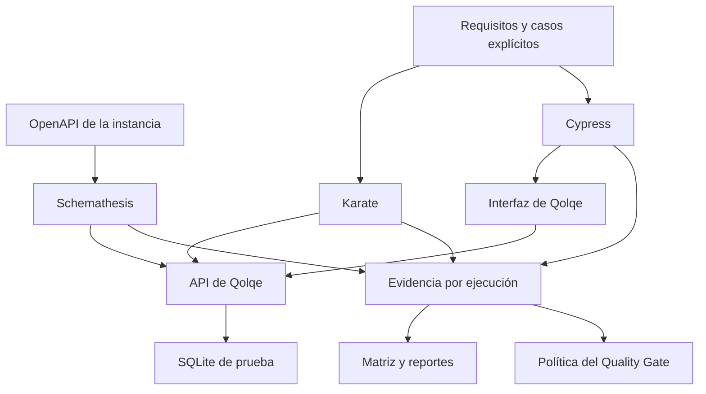

# Arquitectura del kit de verificación

La arquitectura consolidada de la entrega final y el orden contrato → API → web → rendimiento → reportería se documentan en [arquitectura y patrones](final/arquitectura-y-patrones.md). Este documento conserva la descripción inicial del kit.

## Qué se integra

El kit prueba la aplicación Qolqe fijada en la revisión indicada en el README. La aplicación tiene interfaz, API FastAPI y persistencia SQLite; los ejecutores de QA administran instancias y datos de prueba separados.

| Componente | Responsabilidad | Implementación |
|---|---|---|
| Schemathesis | Generar peticiones y checks desde OpenAPI, con contexto preparado | [Ejecutor](../scripts/run_qa.py) y [contexto](../scripts/schemathesis_context.py) |
| Karate | Verificar casos explícitos de contrato, negocio, estados y efectos | [Features](../API/features/) |
| Cypress | Verificar recorridos por la UI y observar sus respuestas reales | [Escenarios](../Web/cypress/e2e/), [páginas](../Web/cypress/pages/) y [datos](../Web/cypress/support/fixtures.ts) |
| Lanzadores | Preparar instancia, comprobar disponibilidad y guardar procedencia | [API](../scripts/run_qa.py) y [Web](../scripts/cypress/run.mjs) |
| Reportería | Relacionar casos, ejecuciones y resultados | [Generador](../scripts/build_delivery.py) y [exportación](../scripts/export_results.py) |
| Quality Gate | Aplicar la política y distinguir fallos nuevos, conocidos e inestabilidad | [Evaluador](../scripts/quality_gate.py) y [política](../data/quality-policy.json) |

Las suites son complementarias. No existe una conversión automática de resultados Schemathesis a casos Karate o Cypress. El diseño de nuevos casos y la clasificación de hallazgos requieren revisión humana.

## Contrato y contexto

Schemathesis lee `/openapi.json` de la instancia ejecutada; la configuración actual usa examples, coverage y fuzzing, sin fase stateful. El [snapshot original](../data/openapi-original.json) y el [contrato capturado](../API/openapi.json) deben contrastarse con el esquema de la ejecución antes de atribuir una discrepancia al contrato original.

Karate prepara usuarios y recursos por escenario. Los [casos técnicos](../API/features/contrato-contactos.feature) comprueban campos y tipos explícitamente. Cypress prepara datos por API, realiza acciones por UI y verifica respuestas y persistencia. Los datos web actuales se implementan en `support/fixtures.ts`; su correspondencia con el formato de fixtures exigido por la consigna sigue pendiente de contraste.

## Vista de ejecución en CI

El [workflow principal](../.github/workflows/pruebas.yml) organiza **API → Web → Reportería**. La secuencia de jobs es una decisión de ejecución; no significa que las suites conviertan sus resultados en pruebas de la siguiente herramienta. Web y Reportería se intentan también tras fallos anteriores para conservar evidencia.

API usa el puerto 8000 y Web el 8011. Cada ejecutor controla su instancia; un puerto ocupado debe investigarse antes de ejecutar. La suite API es secuencial por su estado y reloj compartidos.

## Evidencia y límites

Los manifiestos registran procedencia y los reportes conservan los resultados crudos. La matriz enlaza requisitos y casos diseñados; las interacciones generadas de Schemathesis no equivalen a criterios de aceptación cubiertos.

El gate decide según una política; no convierte un defecto conocido en test aprobado. La evidencia local, un artefacto antiguo y un run remoto del commit presentado son evidencias diferentes. Véanse [política](parte2/quality-gate.md), [pipeline](parte2/pipeline.md) y [decisiones](decisiones.md).
