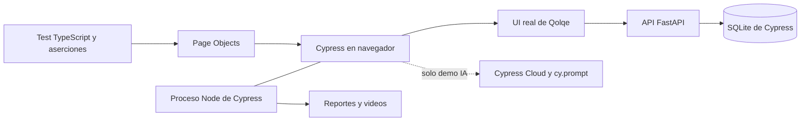

# Arquitectura de la solución

El lanzador Node inicia un solo proceso Python/Uvicorn en 127.0.0.1:8011. Usa la aplicación original y la base exclusiva `.tools/cypress/qolqe.db`. No altera el código bajo prueba ni utiliza la base de Karate.

Mocha organiza `describe` e `it`; Chai proporciona aserciones. Cypress coordina comandos en el navegador y tareas/eventos en Node. No usa Selenium WebDriver como motor. Las consultas/aserciones reintentan hasta su timeout; esto no elimina todos los fallos intermitentes ni repite acciones financieras arbitrariamente.

POM: LoginPage y ContactosPage centralizan selectores y acciones sin guardar sesiones o estado mutable compartido. Las aserciones del negocio quedan en los tests. El custom command prepararContactos evita repetir la preparación. Cypress advierte contra compartir Page Objects con estado; aquí cada escenario crea su contexto.

La regresión funciona sin Cloud. `cy.prompt` requiere la cuenta Cloud y acceso a IA; sus resultados deben revisarse. Cypress guarda snapshots de DOM para depurar; no rebobina la base de datos.

Fuentes: https://www.cypress.io/how-it-works · https://docs.cypress.io/app/core-concepts/best-practices · https://docs.cypress.io/app/guides/ai-test-generation
