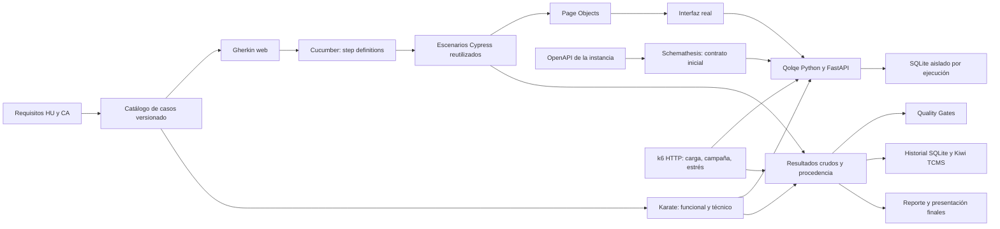

# Arquitectura y decisiones de la entrega final

## Alcance y capas

Evaluamos G4 (contactos y solicitudes) y el núcleo común de Qolqe, no los módulos independientes G1/G2/G3/G5/G6. La evidencia de rendimiento incluye operaciones de otros módulos dentro de la mezcla del requerimiento; eso no acredita su cobertura funcional completa.

## Herramientas complementarias

| Elección | Aporte | Alternativa | Costo y límite |
|---|---|---|---|
| Karate 1.5.2 / Java 17 | Escenarios HTTP explícitos, estados, contratos y efectos persistidos | pytest + httpx, Postman/Newman | DSL técnico y runtime Java; no mide la experiencia visual |
| Schemathesis 4.17.0 | Generación examples/coverage/fuzzing desde OpenAPI, antes de las suites funcionales | Solo ejemplos manuales | Un check fallido es señal de contrato, no un caso funcional ni defecto único; exploración acotada a contactos/solicitudes |
| Cypress 16.2 + Cucumber | Flujos web, Gherkin ejecutable y aserciones sobre interfaz/API real | Playwright, Selenium | Ejecución secuencial por reloj de pruebas compartido; se necesitan navegador y Node compatible |
| k6 2.4 | Modelo HTTP con etapas, etiquetas y criterios versionados | Locust, JMeter, Artillery | Dos lenguajes junto al soporte Python; no se hizo benchmark entre generadores |
| Kiwi TCMS | Planes, casos y ejecuciones diferenciadas mediante API | TestRail (servicio/licencia), hoja CSV (sin ciclo de vida de casos) | Preparado a petición del equipo; sin instancia levantada ni credenciales no se afirma sincronización real |

## Patrón Page Object Model y comparación

Usamos POM para encapsular selectores y acciones en ContactosPage, SolicitudesPage, TransferenciasPage y LoginPage. Las reglas esperadas permanecen en los escenarios; las páginas no deciden si un defecto del producto debe tolerarse. Las fixtures preparan actores por API para reservar la UI a las acciones del escenario.

| Patrón | Ventaja | Evaluación para el contexto |
|---|---|---|
| POM + componentes pequeños | Un cambio de selector se corrige en un lugar; interfaz concreta por pantalla | Elegido para dos integrantes y pocas pantallas; evita duplicación sin introducir una jerarquía extensa |
| Screenplay | Actores, tareas y preguntas reutilizables entre muchos flujos | Conveniente al crecer roles y procesos transversales; mayor inversión inicial de abstracción |
| Fluent Interface / flujos encadenados | Lectura compacta de acciones | Complementa POM; por sí solo no separa selectores ni garantiza oráculos claros |
| Scripts con selectores directos | Inicio rápido | Descartado como arquitectura principal: cambios UI multiplican el mantenimiento |

La escalabilidad se apoya en separar componentes comunes, acciones, datos y aserciones. No proponemos un Page Object gigante ni herencia profunda. Si aumentan roles y flujos transversales, evaluaremos tareas de negocio sobre los objetos actuales. Escalabilidad de mantenimiento no equivale a paralelizar: el reloj global del servidor exige instancias y bases separadas antes de distribuir los escenarios.

## Gherkin y reutilización

`Web/features/*.feature` se ejecuta con el preprocesador Cucumber, no es documentación desconectada. `Web/cypress/steps/web.ts` enlaza cada escenario a su implementación única. Se conservan los cuerpos de las pruebas para no duplicar oráculos ni alterar el comportamiento al migrar. El paso Cuando ejecuta acciones y aserciones existentes; Entonces verifica que esa cadena finalizó. Esta migración es una capa de enlace: un refinamiento posterior puede separar precondiciones, acciones y verificaciones en pasos de negocio más pequeños. El título, las HU, los TC y los grupos identifican el objetivo concreto.

## Fuentes técnicas

- https://github.com/badeball/cypress-cucumber-preprocessor
- https://docs.cypress.io/app/core-concepts/best-practices
- https://grafana.com/docs/k6/latest/using-k6/scenarios/
- https://docs.locust.io/en/stable/writing-a-locustfile.html
- https://kiwitcms.readthedocs.io/en/latest/
