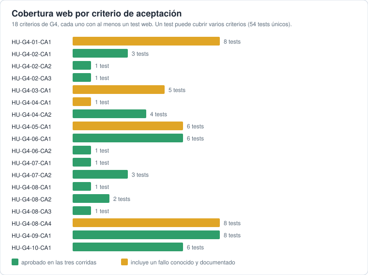
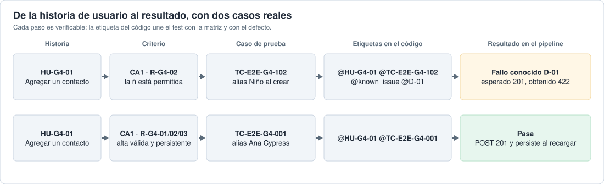
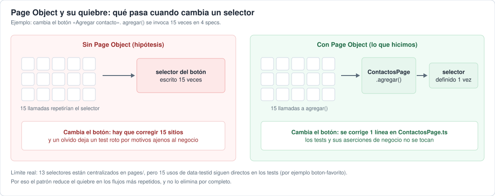
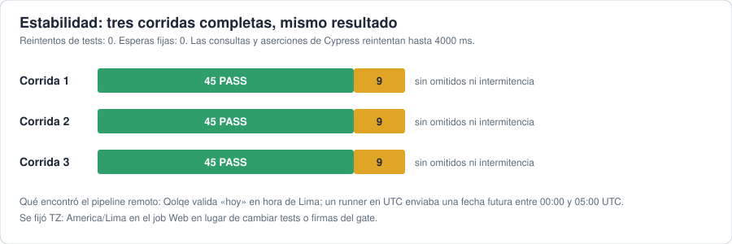
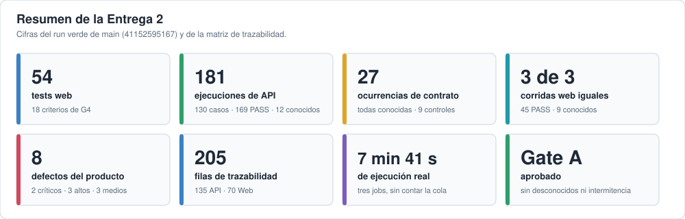
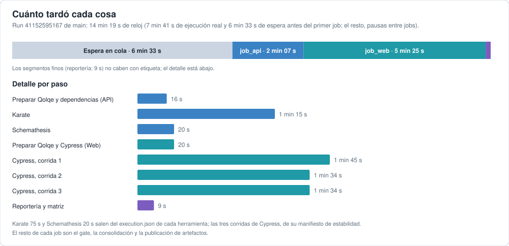

# El porqué de cada criterio de la rúbrica

Para cada criterio: qué hicimos, por qué lo hicimos así y dónde está la evidencia. Las cifras salen de la matriz y del run verde de `main` ([resultado del gate](resultado-gate.md)).

## 1. Cobertura de criterios web con verificaciones significativas (5 pts)

**Qué hicimos.** 54 tests Cypress para los 18 criterios de aceptación de G4, agrupados en 36 variantes. 13 criterios aprobaron en las tres corridas y 5 incluyen un fallo conocido y documentado.

**Por qué así.**
- Los criterios salen del requisito, no de lo que muestra la pantalla. Cada CA tiene al menos un test.
- «Verificación significativa» significa no quedarse en que el botón responda. Cada test comprueba la respuesta HTTP real (`cy.intercept` solo observa, no simula), el mensaje visible, la persistencia tras recargar y que un rechazo no cree ni cambie nada. Ejemplo, `E2E-G4-002`: el alias «Lu» devuelve 422 `ALIAS_INVALIDO`, el error se ve y, tras recargar, hay cero contactos.
- Si falla una aserción, las siguientes no se ejecutan; por eso presencia de código no implica criterio aprobado.

**Evidencia.** [verificacion-web.md](verificacion-web.md) · [alcance-y-matriz.md](alcance-y-matriz.md) · [`Web/cypress/e2e/`](../../Web/cypress/e2e/).

## 2. Pipeline CI/CD con API y web, reportes y estado visible (5 pts)

**Qué hicimos.** Un solo workflow, `pruebas.yml`, con tres jobs en cadena: API y contratos, Web (tres corridas) y reportería. Corre en push o PR a `main` y a mano.

**Por qué así.**
- API y Web son capas distintas: Karate y Schemathesis comprueban reglas y contrato; Cypress comprueba el recorrido de la persona usuaria. Se dejaron en cadena para mantener un orden claro y una sola decisión final.
- Web y reportería usan `if: always()`: la evidencia se conserva aunque falle un job anterior. No hay `continue-on-error`: los reportes crudos conservan los FAIL y el Quality Gate decide después.
- Los defectos son del producto y Qolqe no se modifica. Por eso el gate Escenario A aprueba solo firmas conocidas y documentadas, y bloquea fallos nuevos o inestables.
- Los artefactos duran 7 días para no gastar almacenamiento, y el resumen permanente queda en el repo.
- El estado es visible en Actions y en el resumen de cada run, que enlaza la matriz y los reportes.

**Evidencia.** [`pruebas.yml`](../../.github/workflows/pruebas.yml) · [pipeline.md](pipeline.md) · [quality-gate.md](quality-gate.md) · [resultado-gate.md](resultado-gate.md).

## 3. Gestión de casos y trazabilidad HU → casos → ejecución (3 pts)

**Qué hicimos.** Una matriz exportada (`data/trazabilidad-parte2.csv` y `.json`) con historia, caso, escenario, capa, etiquetas del código, estado en el pipeline y defecto asociado. Son 205 filas: 135 de API y 70 de Web, sobre 130 casos de API y 54 de Web únicos.

**Por qué así.**
- Los tests llevan etiquetas `@HU-…` y `@TC-…` en el código, y la matriz se genera en el job de reportería con los resultados del mismo run. Así no se desincroniza de lo ejecutado.
- Un caso puede cubrir varios criterios, por eso las filas no son pruebas independientes. El gráfico lo aclara.
- El CSV es exportable y versionado; la vista legible es [trazabilidad.md](trazabilidad.md) y el portal navegable, `apidoc/parte2/index.html`.

**Límite.** La «herramienta de gestión de casos» es esta matriz versionada y su portal; conviene confirmar con la docente que basta.

**Evidencia.** [trazabilidad-parte2.csv](../../data/trazabilidad-parte2.csv) · [trazabilidad.md](trazabilidad.md) · [defectos-conocidos.md](defectos-conocidos.md).

## 4. Diseño y estabilidad: patrón mantenible, sin esperas fijas, pasa 3 veces (3 pts)

**Qué hicimos.** Page Object y comandos propios de Cypress, selectores `data-testid`, ninguna espera fija, y tres corridas completas con el mismo resultado: 45 aprobados y 9 fallos conocidos.

**Por qué así.**
- **Page Object.** Los selectores y acciones de cada pantalla viven en `Web/cypress/pages/`, y las aserciones del negocio, en el test. Si cambia un botón, se corrige una línea en lugar de todos los sitios donde se usa. `agregar()` se llama 15 veces en 4 specs; sin el patrón, el selector se repetiría 15 veces. Es una decisión de diseño, no una regla de Cypress: los Page Objects no guardan estado compartido.
- **`data-testid`.** Es un atributo pensado para pruebas y no cambia cuando cambian el diseño o la redacción, a diferencia de una clase de estilo o un texto visible.
- **Sin esperas fijas.** Las consultas y aserciones de Cypress reintentan hasta 4000 ms, así que no hay `cy.wait` con tiempo y los tests no dependen de la velocidad de la máquina. No se usan reintentos de tests que oculten resultados.
- **Tres corridas.** Demuestran estabilidad: mismo resultado, sin omitidos ni intermitencia. El pipeline remoto encontró además una dependencia de la hora: Qolqe valida con hora de Lima y un runner en UTC enviaba una fecha futura entre las 00:00 y las 05:00 UTC. Se corrigió fijando `TZ: America/Lima` en el job Web ([pipeline.md](pipeline.md)).

**Límite real.** 13 selectores están centralizados en `pages/`, pero 15 usos de `data-testid` siguen directos en los tests (por ejemplo `boton-favorito`). El patrón reduce el quiebre en los flujos más repetidos, y no lo elimina por completo.

**Evidencia.** [`Web/cypress/pages/`](../../Web/cypress/pages/) · [`Web/cypress/support/`](../../Web/cypress/support/) · [verificacion-web.md](verificacion-web.md) · [`tests/e2e/README.md`](../../tests/e2e/README.md).

## 5. Exposición y demo en vivo, ambos integrantes responden (4 pts)

**Qué hicimos.** Una presentación de 13 diapositivas, los comandos de la demo y una guía de ensayo. La reportería se muestra en el orden de [reporteria-demo.md](reporteria-demo.md): del run en Actions a la decisión del gate, la matriz y los reportes por herramienta.

**Por qué así.** El pipeline ya produce toda la evidencia: mostrarla desde ahí demuestra que no es un material armado aparte. Los resultados se anuncian después de verlos en pantalla.

**Evidencia.** [PPT](../../presentacion/Entrega2-Qolqe-Cypress.pptx) · [comandos-demo.txt](comandos-demo.txt) · [entrega.md](entrega.md).

---

# Resumen y conclusiones

## Cuánto tardó cada cosa

Medido en el run verde de `main` ([41152595167](https://github.com/granitespinoza/qolqe-g4-qa/actions/runs/41152595167)).

| Qué | Duración | Fuente |
|---|---|---|
| Run completo, de reloj | 14 min 19 s | GitHub Actions |
| Espera antes del primer job | 6 min 33 s | GitHub Actions |
| `job_api`: API y contratos | 2 min 07 s | GitHub Actions |
| &nbsp;&nbsp;Karate | 75 s | `execution.json` de Karate |
| &nbsp;&nbsp;Schemathesis | 20 s | `execution.json` de Schemathesis |
| `job_web`: Web E2E, tres corridas | 5 min 25 s | GitHub Actions |
| &nbsp;&nbsp;Cypress, corridas 1, 2 y 3 | 105 s, 94 s y 94 s | manifiesto de estabilidad |
| `job_reporting`: reportería y matriz | 9 s | GitHub Actions |
| Ejecución real de los tres jobs | 7 min 41 s | suma de los tres jobs |

La mayor parte de la ejecución real es Cypress, que corre tres veces para comprobar estabilidad. La espera inicial no la consume el trabajo, sino el run: esperó a que terminaran otros runs en curso.

## Conclusiones

- **Cumple lo que pide la rúbrica con evidencia.** Hay 54 tests web para los 18 criterios de G4, un pipeline con API, web y reportería en verde en `main`, una matriz de trazabilidad exportada y una suite estable en tres corridas.
- **Encontramos 8 defectos del producto**, de los que 2 son críticos (token válido tras cerrar sesión, concurrencia que supera saldo o límite), 3 altos y 3 medios. Qolqe no se modificó y ninguna expectativa se ajustó para ponerlo en verde.
- **El pipeline remoto enseñó lo que el local no mostraba.** La firma de contrato K-C03 dependía de la plataforma, y el historial dependía de la hora (Qolqe valida con hora de Lima y un runner en UTC enviaba una fecha futura). Ambos se corrigieron sin cambiar tests ni ocultar fallos.
- **«Aprobado» significa Escenario A, no producción.** El gate aprueba solo firmas conocidas y documentadas en una instancia académica aislada: 45 de 54 tests web pasan y 9 fallan por defectos conocidos. No equivale a 54 pruebas aprobadas.
- **Lo que queda abierto.** Confirmar con la docente si `Web/cypress/` sirve como `tests/e2e/` y si la matriz CSV con su portal vale como herramienta de gestión de casos. Los artefactos del run caducan a los 7 días, por eso el resumen permanente está en este repositorio.
