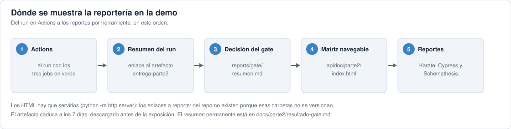
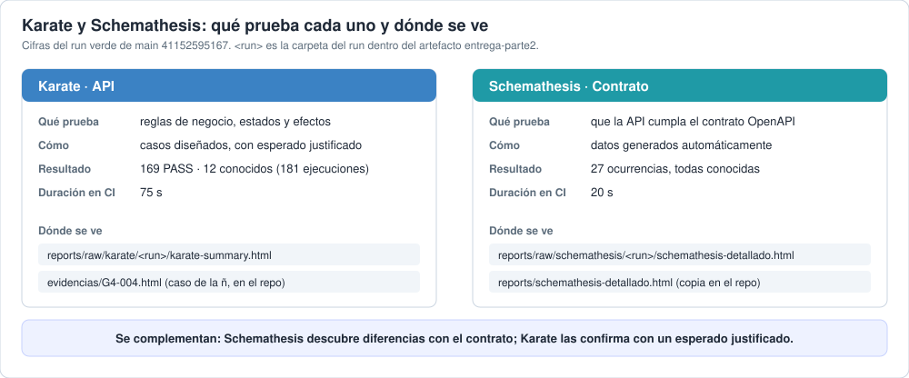

# Dónde mostrar la reportería en la demo



La reportería sale del run de GitHub Actions y de su artefacto `entrega-parte2-<run>-1`. En este orden:

| Paso | Qué mostrar | Dónde |
|---|---|---|
| 1 | El pipeline corriendo, con los tres jobs (API y contratos, Web E2E con tres corridas, Reportería) | Pestaña [Actions](https://github.com/granitespinoza/qolqe-g4-qa/actions) |
| 2 | El resumen del run, con el enlace «Descargar matriz, reportes y presentación» | Página del run → resumen |
| 3 | La decisión del Quality Gate: Escenario A, sin bloqueos | `reports/gate/resumen.md` del artefacto, o [`resultado-gate.md`](resultado-gate.md) en el repo |
| 4 | La matriz navegable: historia → criterio → caso → resultado | `apidoc/parte2/index.html` |
| 5 | Reporte final consolidado, y los XML de API y Web | `results/reporte-final.html`, `results/api-results.xml`, `results/web-results.xml` |
| 6 | Reportes por herramienta | Karate: `reports/raw/karate/<run>/karate-summary.html` · Cypress: `reports/cypress/<run>-regression/html/index.html` (una por corrida) · Schemathesis: `reports/raw/schemathesis/<run>/schemathesis-detallado.html` |

## Karate y Schemathesis: dónde se ven



**Karate (API)**

| Qué | Dónde |
|---|---|
| Resumen de la ejecución | `reports/raw/karate/<run>/karate-summary.html` del artefacto `entrega-parte2` |
| Una página por historia | En esa misma carpeta: `API.features.hu-g4-01.html`, etc. |
| Registro de un caso concreto | [`evidencias/G4-004.html`](../../evidencias/G4-004.html) (la ñ) o [`evidencias/G4-018.html`](../../evidencias/G4-018.html) (duplicado con espacios), en el repo, con los tokens ocultos |
| Resultados consolidados | `results/api-results.xml` y `results/reporte-final.html` del artefacto |

**Schemathesis (contrato)**

| Qué | Dónde |
|---|---|
| Reporte detallado: cada petición, respuesta y check, con filtros | `reports/raw/schemathesis/<run>/schemathesis-detallado.html` del artefacto |
| Copia permanente de una ejecución anterior | [`reports/schemathesis-detallado.html`](../../reports/schemathesis-detallado.html) en el repo |
| Decisión del gate sobre las ocurrencias de contrato | `reports/gate/schemathesis.json` del artefacto y [`resultado-gate.md`](resultado-gate.md) |

En el reporte de Schemathesis, filtrar por categoría (`required`, `type`, `length`, `pattern`, `auth`), abrir un registro y mostrar el dato enviado, la respuesta y el check. Una señal no es un defecto hasta investigarla.

**Ejecutarlos en vivo**, desde la raíz y con la API encendida (`scripts/serve_api.py`):

```powershell
./.venv/Scripts/python.exe scripts/run_qa.py karate --tag '@G4-004'
./.venv/Scripts/python.exe scripts/run_qa.py schemathesis
```

El primero corre solo el caso de la ñ. El segundo tarda unos 20 segundos; la suite completa de Karate, unos 75 s en CI. Cada uno imprime el enlace de su reporte nuevo al terminar.

**Cómo se complementan:** Karate verifica las reglas de negocio con casos diseñados y un esperado justificado; Schemathesis explora el contrato con datos generados. Lo que falla en una se confirma con la otra.

## Verlo en local

Los HTML hay que servirlos; no se abren bien desde el artefacto comprimido. Descargar el del run final y servirlo:

```powershell
gh run download <ID_DEL_RUN> -R granitespinoza/qolqe-g4-qa -n entrega-parte2-<ID_DEL_RUN>-1 -D tmp/entrega-run
python -I -m http.server 8766 --bind 127.0.0.1 --directory tmp/entrega-run
```

Después abrir `http://localhost:8766/apidoc/parte2/`. En macOS o Linux, usar `python3` en lugar de `python`.

## Advertencias

- Los artefactos caducan a los 7 días de cada run: descargar el del run final antes de la exposición.
- Los enlaces a `reports/` desde el repo no existen: Git ignora `reports/raw` y `reports/cypress`.
- Si el servidor falla en vivo, usar [`resultado-gate.md`](resultado-gate.md) y el README: tienen el resumen y los gráficos, y no caducan.
- Los resultados se anuncian después de verlos en pantalla, no antes.
